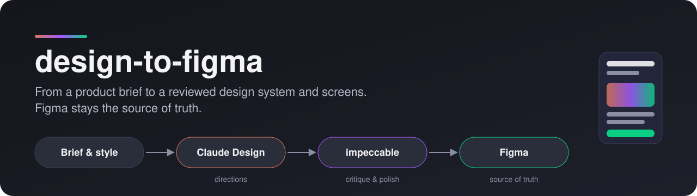
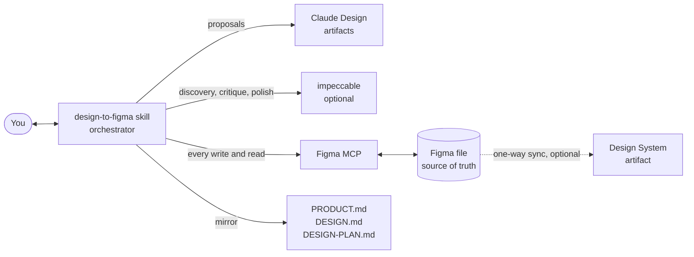
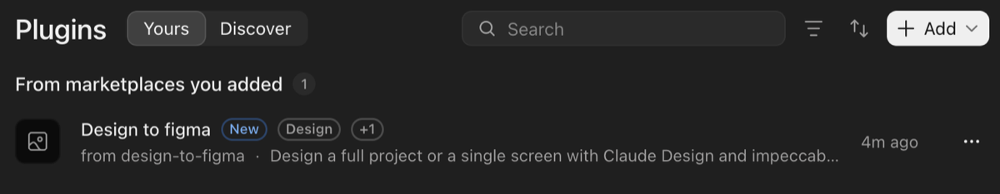
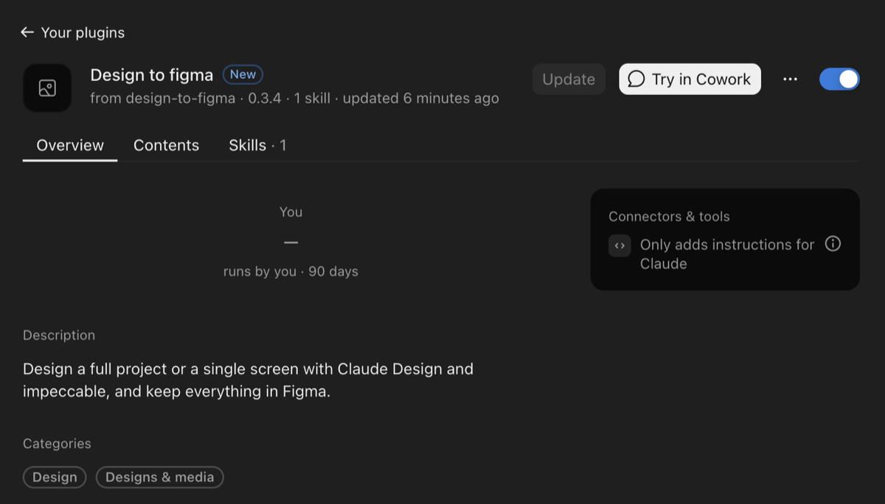
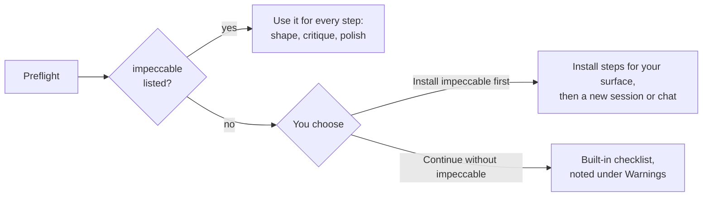
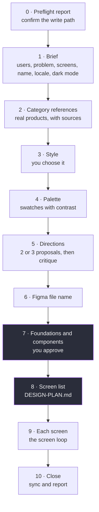
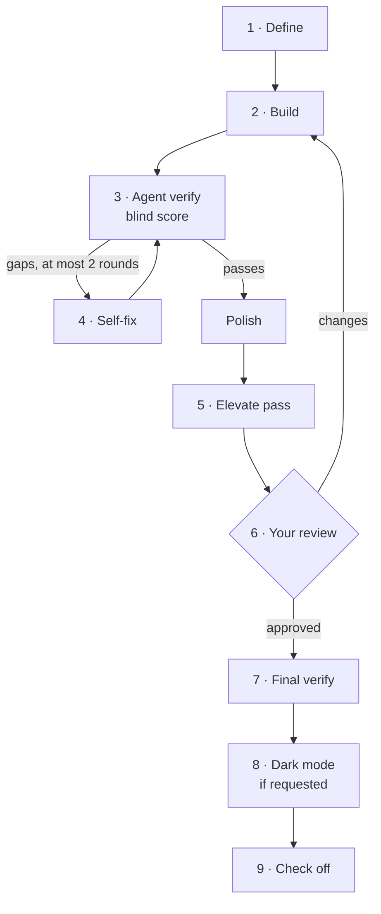
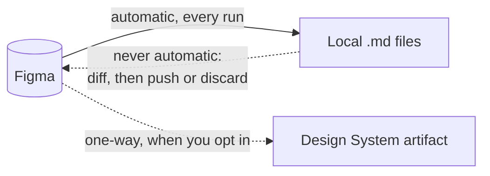

<p align="center">
  
</p>

<p align="center">
  
  
  
  
</p>

A Claude plugin for design work that must end up in Figma. It takes you from the product brief through the style, the directions and the screens, and builds the result in Figma, which stays the source of truth. It coordinates three tools: **Claude Design** for the proposals, **[impeccable](https://impeccable.style)** (optional) for discovery, critique and polish, and the **Figma MCP** for every write.

It designs; it does not write product code.

## Contents

- [Quick start](#quick-start)
- [What it does](#what-it-does)
- [How it works](#how-it-works)
- [Requirements](#requirements)
- [Install in Claude Code](#install-in-claude-code)
- [Install in Claude Desktop](#install-in-claude-desktop)
- [impeccable (optional)](#impeccable-optional)
- [Usage](#usage)
- [The design flow](#the-design-flow)
- [The screen loop](#the-screen-loop)
- [Figma and your local files](#figma-and-your-local-files)
- [Updating](#updating)
- [Troubleshooting](#troubleshooting)
- [Development](#development)
- [License](#license)

## Quick start

| | Claude Code | Claude Desktop |
|---|---|---|
| 1. Figma | `claude plugin install figma@claude-plugins-official` | **Customize → Connectors**: add and connect Figma |
| 2. Marketplace | `claude plugin marketplace add UrielEscorcia/design-to-figma` | **Customize → Plugins → Add → Add marketplace**: `UrielEscorcia/design-to-figma` |
| 3. Plugin | `claude plugin install design-to-figma@design-to-figma` | Open **Design to figma** and select **Add** |
| 4. Try it | New session: *"Design one screen in Figma: …"* | New chat: *"Design one screen in Figma: …"* |

## What it does

| Mode | When | What you get |
|---|---|---|
| **Full project** | Several screens, or a design system | Brief, style, 2 or 3 directions, foundations and components in Figma, then every screen through the review loop |
| **Single screen** | One screen or view | The same quality bar for one screen, reusing an existing system or bootstrapping a minimal one |
| **Iteration** | Changes to an existing design | Figma is read first, so manual edits in Figma are kept; the change is applied there and synced back |

Ground rules it follows on every run:

- **One question at a time.** It asks, waits for your answer, and records it before the next step.
- **Nothing is written to Figma before you approve the direction.**
- **Figma is the source of truth.** Local files mirror Figma, never the other way around without asking.
- **It replies in your language.** UI copy uses the language and locale from the brief.

## How it works



The skill does not design by itself: it decides which tool runs when, keeps every decision in Figma, and keeps the local files consistent with it.

## Requirements

| Requirement | Needed | Notes |
|---|---|---|
| Figma MCP | **Yes** | The skill stops when it is missing. It needs a Figma Dev or Full seat; View and Collab seats get 20 MCP calls a month, which is not enough. |
| Figma plugin skills | Recommended | `figma-use`, `figma-generate-design`, `figma-generate-library`, `figma-create-new-file`. They come with the Figma plugin in Claude Code. Without them the skill continues with reduced quality rules. |
| impeccable | Optional | Deeper discovery, critique and polish. When it is missing, the skill asks whether to install it or continue with its built-in checklist. |
| Claude Design | Built in | Proposals render as Design artifacts. Without it they go to a `🧪 Explorations` page in Figma. |

## Install in Claude Code

1. Install the Figma plugin, which brings the Figma MCP and its skills:

   ```sh
   claude plugin install figma@claude-plugins-official
   ```

2. Add this marketplace and install the plugin:

   ```sh
   claude plugin marketplace add UrielEscorcia/design-to-figma
   claude plugin install design-to-figma@design-to-figma
   ```

3. Optional: install impeccable from https://impeccable.style.
4. Start a new session.

## Install in Claude Desktop

Plugins in Desktop are saved to your claude.ai account, so they also work in chat on the web and in Cowork.

1. **Figma:** under **Customize → Connectors**, add the Figma connector, then connect and authorize it.
2. **Marketplace:** under **Customize → Plugins**, select **Add → Add marketplace** and enter `UrielEscorcia/design-to-figma`.
3. **Plugin:** open **Design to figma** and select **Add**. It appears under **Yours**, in *From marketplaces you added*:

   

4. Open the plugin to check the version and that its toggle is on:

   

5. Optional: add impeccable ([next section](#impeccable-optional)).
6. Start a new chat.

> [!NOTE]
> A plugin installed on your account also reaches Claude Code as a synced plugin at the next session start. If you already installed it from the command line, keep one of the two copies.

<details>
<summary><b>Alternative: upload the skill as a zip</b></summary>

Use this only when you cannot add a marketplace (for example, an organization that blocks it). Updates are then manual uploads.

1. From a clone of this repository, build the zip. It must contain the `design-to-figma` folder itself:

   ```sh
   cd skills && zip -r ../design-to-figma.zip design-to-figma
   ```

2. Upload `design-to-figma.zip` under Settings → Capabilities → Skills.
3. Start a new chat.

</details>

## impeccable (optional)

impeccable adds deeper discovery, critique and polish. The skill checks for it at the start of every run, on every surface:



- **Claude Code:** install it from https://impeccable.style.
- **Claude Desktop:** the upstream folder cannot be uploaded as is. Build a personal copy (below).

<details>
<summary><b>Build a personal impeccable copy for Claude Desktop</b></summary>

Desktop rejects some of impeccable's frontmatter keys and descriptions over 200 characters. Starting from an installed impeccable (for example `~/.claude/skills/impeccable`):

1. Copy the `impeccable` folder somewhere else.
2. In its `SKILL.md` frontmatter, remove the `version`, `user-invocable` and `argument-hint` keys. Keep `license`.
3. Shorten `description` to 200 characters or less.
4. Remove `scripts/bin/` (native binaries that cannot run in the Desktop sandbox).
5. Zip the `impeccable` folder and upload it under Settings → Capabilities → Skills.
6. Start a new chat.

impeccable is licensed under Apache 2.0. Keep its license notice in the copy and list the changes you made. The copy is for your own use: do not share or redistribute it. This repository does not include it.

On Desktop, impeccable's launcher cannot run. It says "Context loading did not run" and reads `PRODUCT.md` and `DESIGN.md` directly. That is expected.

Rebuild the copy only when impeccable releases a new version.

</details>

## Usage

Ask in plain words. The skill loads when the request has a Figma destination:

> *"Design a booking app for a barbershop in Figma: login, service list and checkout."*
>
> *"Design one screen in Figma: the pickup checkout for a coffee shop."*
>
> *"In my Figma file, make the cards denser and change the primary color."*

The first reply is always a **preflight report**:

| Line | Example |
|---|---|
| Figma tools | ok, or BLOCKED with install steps |
| Seat note | Dev or Full seat needed |
| impeccable | used, or missing and asked next |
| Design surface | Claude Design artifacts, or the Figma fallback |
| Web research | available, or references marked unverified |
| Write path | the folder for `PRODUCT.md` / `DESIGN.md`; **confirm it here** |

Then the brief starts, one question at a time.

## The design flow

Each step is one turn: the skill asks, waits for your answer, and records it.



Steps 7 and 8 (purple) are project mode. In screen mode, the screen is defined before the directions, and only the tokens and components the screen needs are built.

The Figma file gets four pages:

| Page | Contents |
|---|---|
| `📋 Brief & Rules` | Product summary, style and references, design principles, usage rules |
| `🎨 Foundations` | Variable collections and text and effect styles |
| `🧩 Components` | Component sets with variants, bound to the variables |
| `📱 Screens` | The screens, grouped by flow |

## The screen loop

Every screen, in both modes, runs the same loop before the next one starts:



The review message always has five fields, so you can decide without asking:

| Field | Content |
|---|---|
| Verdict | Pass or fail against the quality gate |
| Score | The blind reviewer's score |
| Polish | What the polish pass checked and fixed |
| Elevate | Kept or discarded and what it changed, or why it was skipped |
| Open gaps | Open issues and product decisions for you, or "none" |

The loop has a fixed budget (one build, at most two self-fix rounds, one polish and one elevate pass) and counts Figma MCP calls against the daily limit of your seat, so a long project stops at a clean point instead of halfway through a screen.

## Figma and your local files



| File | Content |
|---|---|
| `PRODUCT.md` | The brief: users, problem, screens, language and locale, dark mode |
| `DESIGN.md` | The chosen style, tokens and components, with the Figma file header and a sync snapshot |
| `DESIGN-PLAN.md` | Project mode: the screen list and the status of each step, so work can resume later |
| `.impeccable/` | impeccable's own state, when impeccable is used |

Where they are written depends on what the session can write:

| Session | Files go to |
|---|---|
| Claude Code | The project folder |
| Desktop with a connected local folder (Cowork, or the unified Claude experience) | That folder |
| No writable folder (web, mobile, desktop app closed) | Downloads |

## Updating

| Surface | How |
|---|---|
| Claude Code | `claude plugin marketplace update design-to-figma`, then `claude plugin update design-to-figma@design-to-figma` |
| Claude Desktop | **Customize → Plugins → Design to figma → Update**. The button is active only when a new version is available |
| Zip upload | Build a new zip and upload it again |

A new version reaches you only when its version number changes; every change to the skill bumps it.

## Troubleshooting

| Symptom | What to do |
|---|---|
| The preflight report says Figma tools BLOCKED | Install the Figma plugin (Code) or connect the Figma connector (Desktop), then start a new session or chat |
| Figma calls fail with a limit error | Your seat has a low MCP limit; a Dev or Full seat is needed |
| The skill does not load | Check that the plugin is enabled, start a new chat, and mention Figma in the request |
| impeccable is installed but not used | Start a new session or chat; on Desktop, check it is listed under Skills |
| Two copies of the plugin in Claude Code | One comes from the command line and one synced from your account; keep one |
| Desktop's **Update** button is grey | You already have the latest version |

## Development

```sh
tests/run.sh
```

It validates the skill frontmatter and structure, checks the rules the trials depend on, and requires a version bump in `.claude-plugin/plugin.json` and the `SKILL.md` metadata for any change to the skill.

## License

MIT. See [LICENSE](LICENSE).
